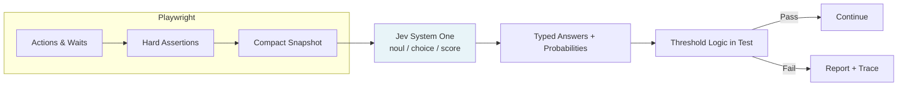

# TL;DR / Executive Summary

Traditional AI-driven browser testing that feeds full accessibility trees into generative LLMs on every step produces snapshot bloat, high latency, and non-deterministic output that is difficult to assert against. The decision-map pattern keeps Playwright responsible for navigation, typing, waiting, and hard URL or network checks while reserving TypeSafe Jev—a System One model that returns only typed probabilities—for narrow, fuzzy judgments. A single Jev call can answer multiple questions (noul, choice, score) against a compact snapshot in roughly 70–500 ms at $0.042 per million input tokens with free output. This article supplies the architecture, threshold discipline, implementation phases, and ready-to-use patterns that let an SDET team in a Mumbai capital-markets back office add semantic resilience to margin and post-trade screens without replacing their existing Playwright suite. Start by instrumenting one high-churn page with a single batched Jev evaluation and a 0.85 confidence threshold this week.

# Quick Glossary

- **System One model**: A class of models (Jev is the first public example) trained for calibrated, typed decisions rather than text generation. They evaluate a state and return structured answers with probabilities.
- **Jev**: TypeSafe AI’s flagship System One model. Current stable alias `jev-latest` points to `jev-1.14.0` (as of October 2026); `jev-1.13.0` remains available.
- **Noul**: Yes/no primitive. Returns a probability between 0.0 and 1.0 that the statement is true.
- **Choice**: Selects one option from a closed set you define (maximum 255). Returns the winner plus the full probability distribution and a confidence score.
- **Score**: Places content on an ordered scale you describe (2–10 levels). Returns a probability-weighted numeric score.
- **Decision map**: The explicit split in which Playwright owns deterministic actions and hard assertions while Jev owns only narrow, typed semantic judgments.
- **ARIA snapshot**: Playwright’s `locator.ariaSnapshot()` output—a compact accessibility tree used as the primary state payload for Jev.
- **Confidence / calibration**: Jev returns probabilities that are calibrated across groups of predictions; individual answers still require your own thresholds and fallbacks.
- **Snapshot bloat**: The practice of repeatedly sending large DOM or accessibility trees (often 100k–200k+ tokens) into a generative LLM on every agent turn.

# Knowledge & Skills Required

**Prerequisites**
- Comfort writing and maintaining Playwright TypeScript tests, including locators, page object patterns, route mocking, and custom expect matchers.
- Ability to reason about test reliability, flakiness sources, and the difference between hard assertions and soft semantic checks.
- Basic familiarity with API clients, environment variables, and structured JSON responses.

**Nice to Have**
- Experience with capital-markets or regulated UIs (margin dashboards, trade blotters, settlement screens) where copy and layout change frequently while business meaning stays stable.
- Prior exposure to LLM-as-judge patterns so you can contrast them with System One constraints.
- Comfort reading TypeScript async code and Playwright’s accessibility APIs.

# Tradeoffs & Mitigations

## Core Approach Comparison

| Approach | Pros | Cons | Mitigation Strategy | When to Choose |
|----------|------|------|---------------------|---------------|
| Pure Playwright locators + hard assertions | Fast, deterministic, zero external cost, excellent for stable selectors | Brittle when copy, layout, or regulatory wording changes; high maintenance on high-churn screens | Combine with data-testid strategy; reserve Jev only for the variable surface | Stable pages, critical path flows that must never be fuzzy |
| Generative LLM (GPT/Claude) agent loop | Flexible natural-language goals, can invent next steps | Snapshot bloat, 1.5–8+ s latency, non-deterministic text that must be parsed, higher cost, hallucination risk | Use only for initial test generation or rare exploratory flows; never in the regression loop | One-off exploration or code generation, not CI regression |
| Jev Decision Map (this pattern) | 70–500 ms typical, $0.042/M input + free output, typed answers, batch multiple questions, offline mock possible | Requires careful question design; probabilities need thresholds; early-access rate limits and model versioning | Pin model version, set explicit thresholds (e.g. 0.85), keep snapshots compact, always retain hard Playwright checks | High-churn semantic surfaces (status banners, dynamic button text, page-state classification) |

**Key Insight**: The highest-leverage split is not “AI vs no AI.” It is “deterministic Playwright for actions and hard checks + System One for narrow typed judgments.” Generative models remain useful for authoring and exploration; they are expensive and unreliable inside the tight regression loop.

## Threshold and Fallback Matrix

| Signal | Recommended Threshold | Fallback Action | Notes |
|--------|-----------------------|-----------------|-------|
| Noul “is signed-in profile visible?” | ≥ 0.90 | Fail test or retry once | High-stakes auth state |
| Choice “which page category?” | Highest probability ≥ 0.75 and clear margin over second | Log and continue with Playwright locator | Useful for routing, not blocking |
| Score “relevance of error banner” | ≥ 2.0 on 0–3 scale | Capture screenshot + attach to report | Soft signal for triage |
| Any question with confidence < 0.60 (where returned) | Treat as uncertain | Escalate to hard locator or human review | Calibration is group-level, not per-call guarantee |

# What It Is Not

- **Not** a replacement for good locator strategy or page objects. Jev amplifies resilience on the semantic layer; it does not invent stable selectors.
- **Not** a generative agent that writes next actions or free-form explanations. Jev returns only the typed answers you asked for.
- **Not** free of thresholds. A 0.62 noul is not “yes”; your code must decide what probability is actionable.
- **Not** suitable for open-ended extraction, multi-hop reasoning, or writing test code. Use a generative model for those tasks and Jev for the subsequent verification.
- **Not** a silver bullet for flakiness caused by timing, network, or race conditions. Those remain Playwright and application concerns.
- **Not** requiring you to abandon existing suites. The pattern layers on top of current tests; start with one or two high-value semantic checks.

# Solutions / Implementation Plan

## Phase 1: Foundation (Days 1–3)

1. **Establish the decision map**
   - Document which steps stay pure Playwright (navigation, form fill, hard URL, network idle).
   - Identify 2–3 semantic questions that currently break when copy or layout shifts (example: “Is the margin relief banner indicating approved status?”).

2. **Install and pin**
   - Add `@playwright/test` and `@typesafe-ai/sdk`.
   - Pin `defaultModel: "jev-1.14.0"` (or `jev-latest` once stable for your thresholds).
   - Create a thin `JevAutomationHelper` that accepts a compact state object and a questions map, with an offline deterministic mock when `TYPESAFE_API_KEY` is absent.

3. **Define the snapshot contract**
   - Prefer `page.getByRole("main").ariaSnapshot()` or a custom text builder that includes URL, title, and visible control labels only.
   - Keep state under a few thousand tokens. Avoid full page HTML.

## Phase 2: First Production Checks (Week 1)

1. **Batch questions in a single call**
   - Example state for a margin dashboard after SEBI relief processing:
     ```ts
     const state = { url: page.url(), snapshot: await page.locator("main").ariaSnapshot() };
     const { answers } = await jev.evaluateSnapshot(state, {
       isApproved: noul("Is the margin relief request shown as approved?", {
         true: "Approved status, relief amount, and confirmation text visible",
         false: "Pending, rejected, or error state"
       }),
       pageCategory: choice("What page state is displayed?", {
         approved: "Relief approved with details",
         pending: "Awaiting processing",
         error: "Error or access denied"
       })
     });
     expect(answers.isApproved.noul).toBeGreaterThan(0.9);
     expect(answers.pageCategory.choice).toBe("approved");
     ```

2. **Add a custom matcher**
   - Extend Playwright `expect` with `toSatisfySemanticCheck(question, threshold = 0.85)` that internally calls the helper. Keep the threshold visible in the failure message.

3. **Instrument observability**
   - Log model version, token usage, latency, and chosen probabilities on every call. Attach the snapshot and answers to the Playwright report on failure.

## Phase 3: Hardening and Scale (Month 1+)

- Introduce failure-classification helper (flake vs genuine, severity, recommended action) that itself uses Jev on the error context plus recent trace summary.
- Cache identical snapshot + question pairs for short windows in CI when the page is static.
- Version the question texts and criteria alongside your test code.
- Add a lightweight offline mock suite so developers can run the suite without an API key.
- Monitor cost: a typical regression step with a 2 k token snapshot and three questions costs well under $0.0001.

**Running Example Thread**: Throughout this article we follow a senior SDET at a Mumbai capital-markets broker maintaining the post-trade and margins back-office suite. Regulatory wording (SEBI margin relief notices, status banners) changes several times a quarter; the decision-map pattern keeps the tests green without constant locator rewrites.

# LLM Prompts

These prompts are intended for the generative model you use to author or refine Jev questions and criteria. Jev itself does not generate text.

## Prompt 1: Question Designer for a Semantic Check

**Goal**: Turn a natural-language assertion into a precise noul or choice question with clear criteria.

**Input Variables**:
- `{{page_context}}` (short description or sample snapshot)
- `{{business_assertion}}` (what must be true)
- `{{variations_to_tolerate}}` (copy or layout changes that should still pass)

**Output Format** (strict JSON):
```json
{
  "primitive": "noul | choice | score",
  "instructions": "exact question text",
  "criteria": { "true": "...", "false": "..." } or { "option1": "desc", ... },
  "recommended_threshold": 0.85,
  "rationale": "one sentence"
}
```

**Success Criteria**: The instructions are unambiguous, criteria distinguish the pass and fail cases, and the primitive matches the decision shape.

## Prompt 2: Snapshot Compaction Reviewer

**Goal**: Review a raw ariaSnapshot and propose a smaller, higher-signal state payload.

**Input Variables**:
- `{{raw_snapshot}}`
- `{{questions_to_answer}}`

**Output Format**:
```json
{
  "recommended_state": "compact text or JSON",
  "estimated_token_reduction": "percentage",
  "risks": ["list"]
}
```

## Prompt 3: Failure Classification Designer

**Goal**: Design the set of choice/noul questions used after a test failure to classify flake vs genuine and recommend action.

**Input Variables**:
- `{{error_message}}`
- `{{recent_actions}}`
- `{{page_snapshot_on_failure}}`

**Output Format**: JSON with `failure_type`, `severity`, `recommended_action` (retry / update_test / file_ticket / investigate) plus the exact Jev questions that produced them.

# What I Wish I Knew Earlier

1. **Batching is free in latency terms.** Asking three related questions in one call costs almost the same wall-clock time as asking one, because Jev evaluates them in parallel against the shared state. Most early prototypes made serial calls and paid unnecessary round-trips.
2. **Thresholds are product decisions, not model properties.** A 0.87 noul that is acceptable on a marketing banner is unacceptable on an authentication state. Document the threshold next to the question.
3. **Compact snapshots beat full accessibility trees.** Sending only the main landmark plus visible button and heading text reduced tokens by 70–80 % and improved calibration on our margin screens compared with raw `page.ariaSnapshot()`.
4. **Offline mocks are non-negotiable for developer velocity.** The deterministic mock that keys off simple string presence let the team iterate on question wording without burning API quota or waiting for network.
5. **Generative models still belong in the authoring loop.** Use Claude or GPT to draft the first version of instructions and criteria; then freeze them and let Jev evaluate. Mixing generation and evaluation inside the same regression step re-introduces the original cost and reliability problems.
6. **Version the model.** `jev-latest` is convenient until a silent upgrade shifts your carefully tuned 0.90 threshold. Pin to `jev-1.14.0` (or the current stable) once the suite is green.

# Visual Aids

## ASCII Flow Diagram — Decision Map Loop

```
Playwright action (goto / fill / click)
          │
          ▼
Hard assertion (URL, network, exact text if stable)
          │
          ▼
Capture compact state (URL + main ariaSnapshot)
          │
          ▼
Single Jev call (noul + choice + score batched)
          │
          ▼
Apply thresholds in code
          │
     ┌────┴────┐
     │ Pass    │ Fail → attach snapshot + answers + screenshot
     └─────────┘
```

## Mermaid Diagram — Component Responsibilities



**Figure 1**: Playwright owns the deterministic spine; Jev supplies only the typed semantic judgments. The feedback path on failure is ordinary Playwright reporting plus the attached Jev answers.

# Quick Decision Checklist

| Situation | Recommended Approach | Avoid or Defer | Red Flags |
|-----------|----------------------|----------------|-----------|
| Stable selector, exact text must match | Pure Playwright locator + `toHaveText` | Jev noul | Adding AI where none is needed |
| Copy or regulatory wording changes quarterly | Jev noul or choice against compact snapshot | Hard-coded string assertions | Tests failing on every SEBI notice update |
| Need to pick among 3–8 dynamic buttons | Choice primitive with clear option descriptions | Generative “click the right button” agent | More than ~20 options without a prior filter |
| High-stakes auth or money movement | Hard Playwright checks first; Jev only as secondary signal | Sole reliance on noul ≥ 0.9 | No fallback path when probability is borderline |
| CI cost or latency budget tight | Batch questions; pin model; monitor tokens | Serial generative LLM calls per step | Snapshot size > 10 k tokens per call |
| Early exploration of a new flow | Generative model to draft steps, then freeze into Playwright + Jev | Leaving the generative loop in regression | No deterministic assertions remain |

**Use this checklist** when adding the next semantic check or when reviewing a flaky test that someone proposes to “just fix with AI.”

# References & Further Reading

1. **TypeSafe AI — Introducing System One Models & Jev** (official blog) — Foundational description of the System One vs System Two distinction, latency and cost claims, and the RLCD training approach. [https://typesafe.ai/blog/introducing-system-one-models-and-jev]
2. **TypeSafe Docs — Models & System One API** — Current model IDs (`jev-1.14.0`, `jev-latest`), context limits (64 k / 262 k), pricing confirmation, and the `/v1/systemone` contract. [https://docs.typesafe.ai/models] [https://docs.typesafe.ai/api]
3. **TypeSafe Docs — Primitives (Choice, Score, Noul)** — Precise guidance on when to use each primitive and how confidence is derived. [https://docs.typesafe.ai/primitives]
4. **Jason Arbon — “I Put Jev in a Playwright Browser Testing Loop”** (Sep 2026) — Independent timing measurements and discussion of where intelligence should and should not live. Useful calibration against vendor claims.
5. **jonymusky/jev-browser-qa** and **Sandesh-S-Dalvi/playwright-jev-testing** — Open-source reference implementations showing `pick`, `runGoal`, semantic expect, and failure-classification patterns on top of Playwright.
6. **QA Wolf — Semantic assertions with Jev** — Practical write-up of `toSatisfy` style matchers and the boundary between what may vary and what must stay exact.
7. **Playwright Accessibility Snapshot docs** — Official reference for `ariaSnapshot()` which forms the recommended compact state. [https://playwright.dev/docs/api/class-locator#locator-aria-snapshot]

# Key Takeaways / Bottom Line

- Keep Playwright in charge of every action and every hard assertion; use Jev only for the narrow semantic questions that change with copy or layout.
- Batch related noul, choice, and score questions into a single call against a compact snapshot. Latency stays low and cost is negligible at $0.042 per million input tokens.
- Treat returned probabilities as signals that require explicit thresholds you own; document those thresholds next to the questions.
- Pin the model version once thresholds are tuned, retain an offline mock for local development, and attach the Jev answers to failure reports.
- Generative LLMs remain valuable for authoring questions and exploring new flows; they do not belong inside the regression loop.
- For a Mumbai capital-markets back-office suite facing frequent SEBI-driven wording changes, the decision-map pattern reduces locator maintenance while preserving deterministic CI behaviour.

The practical next step is to select one high-churn page (margin status banner or trade blotter header), write two batched questions, set a 0.85–0.90 threshold, and run the check both with the live API and the offline mock. Measure token count and latency on the first ten runs; the numbers will confirm whether the pattern belongs in the rest of the suite.
